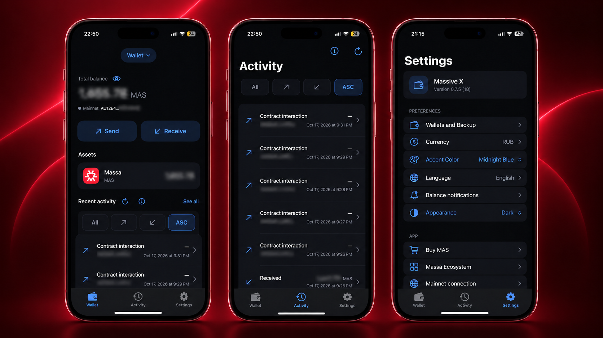

# Massive X Android

A native Kotlin / Jetpack Compose, self-custodial wallet for **Massa Mainnet**. Independent community software; not affiliated with or endorsed by Massa Labs.

**Android Public Testing · 0.5.0 (1)** · Android 8.0+ · Signing wallets and Send require Android 11+ and a secure device lock.

**[Download the signed testing APK](https://github.com/whoisfedor/massive-x-android/releases/download/v0.5.0-beta.1/Massive-X-Android-0.5.0-beta.1.apk)** · [Release notes](https://github.com/whoisfedor/massive-x-android/releases/tag/v0.5.0-beta.1) · [All releases](https://github.com/whoisfedor/massive-x-android/releases)

This is an early public testing build, not an independently audited wallet or a Google Play release. Begin with disposable, unfunded wallets. Any later use with small funds is your own decision and risk; no funded transfer was performed to qualify this release.

## Interface preview

<p align="center">
  <a href="screenshots/1.png"></a>
</p>

*Owner-supplied promotional preview using iOS device frames, with financial details blurred. This is not a verified Android device screenshot; the Android interface and version differ.*

Six languages: English, French, Russian, Spanish, Simplified Chinese and German. Website: [massive-x.com](https://massive-x.com/) · Support/security: [info@massive-x.com](mailto:info@massive-x.com).

## Install the APK

1. Download **`Massive-X-Android-0.5.0-beta.1.apk`** from the tag-specific link above. Avoid APKs re-signed or redistributed by unknown parties.
2. Optionally download [SHA256SUMS](https://github.com/whoisfedor/massive-x-android/releases/download/v0.5.0-beta.1/SHA256SUMS) into the same directory and verify:

   ```sh
   shasum -a 256 -c SHA256SUMS
   ```

   On Linux, use `sha256sum -c SHA256SUMS`. Windows PowerShell: `Get-FileHash .\Massive-X-Android-0.5.0-beta.1.apk -Algorithm SHA256` and compare the result with SHA256SUMS.
3. Open the APK. If Android asks, allow **Install unknown apps** only for the browser/file manager you chose. You can revoke that permission after installation. Normal sideload warnings may appear. Do not disable Play Protect or phone security.
4. Open Massive X. Create a new disposable wallet or import only your own backed-up key. Keep an independent private-key backup offline. A device backup or reinstall is not wallet recovery.

Package: `com.massivex.android`. The development build uses the separate package `com.massivex.android.dev`. Do not uninstall or clear a funded installation to overcome an update/signature conflict; preserve its backup and stop for a compatibility review.

As checked on October 26, 2026, Android developer-verification protections began September 30 for participating stores in Brazil, Indonesia, Singapore and Thailand on certified Android 7+ devices, with broader rollout planned. This project does not claim developer-verification registration or universal sideload availability. Consult [Google’s current verification guidance](https://developer.android.com/developer-verification) if your device/region blocks installation; follow the platform’s supported process.

## Features and compatibility

| Capability | This build |
|---|---|
| Watch-only wallets | Android 8.0+ / API 26+; public reads and Receive without signing keys |
| Create / private-key import / protected backup / Send | Android 11+ / API 30+, secure PIN/password/pattern and supported device authorization required; fails closed otherwise |
| Import encrypted YAML | Supported single-account Massa Version 1 format and its existing password |
| Multiple wallets | Select, name, rename, authenticated backup and scoped removal; unresolved transfer locks prevent unsafe removal |
| Mainnet | Confirmed/candidate balances, public QR/copy/share, indexed activity, exact MAS amounts, fee-aware Max and native transfer review |
| Personalization | Dark/Light/System, three accent colors and four icons; **Classic is the default** |
| Estimates | Optional fiat/crypto estimates via public providers; unavailable/stale quotes do not invent balances |
| Notifications | Optional confirmed-balance checks, off by default; Android/OEM scheduling may delay or suppress them |

No recovery-phrase/BIP39 derivation, YAML export, staking, other chains, hardware-wallet integration or cloud recovery is advertised. The phone interface requests portrait. Android large-screen/windowing behavior may differ.

## Mainnet Send is enabled

**The published Release APK supports real owner-initiated Mainnet MAS transfers.** It is not a no-broadcast preview. Debug and Release share the same safety pipeline. Testing this publication did not submit a real operation.

A transfer requires an immutable review, deliberate slide (or explicit accessibility confirmation), fresh device authorization, exact local signature verification, durable signed/submission-attempt records and a single scoped official-RPC attempt. Ambiguous outcomes are never automatically resent. Source locks release only after matching separated final reports and durable terminal resolution under the official-provider trust policy. Missing, expired, pruned or conflicting evidence stays unresolved.

Never repeat a payment because a response timed out. Preserve the original operation ID and reconcile that operation. Using the same key on multiple devices can create conflicts the local journal cannot prevent. Android does not implement the separate iOS historical-explorer recovery flow.

## Security and recovery

- Per-wallet seeds are encrypted with Android Keystore AES-GCM, with identity-bound metadata and fresh action authorization. Keystore wrapping is not hardware-backed Ed25519 signing, and hardware backing is not assumed on every device.
- Keys and protected records are excluded from Android backup/device transfer. Keystore loss/invalidation, lock changes, app removal or device loss can make local keys unrecoverable. Keep a valid independent key backup.
- Ordinary public pages allow screenshots. Private-key/password entry and on-screen key reveal use `FLAG_SECURE`; reveal masks on exit/background and after 30 seconds. External cameras and a compromised OS remain outside this control.
- A freshly authorized private-key copy is marked sensitive but remains on the system clipboard after leaving/backgrounding. Manual Clear only affects the matching app-owned current clip. Android 13+ can auto-clear it; other apps/keyboards or a user-directed paste may expose it. Clipboard copying is not an offline backup.
- Complete local-storage rollback, rooted/compromised devices, in-process memory copies, multi-device spending, provider dishonesty and missing history remain risks. Automated/internal review is not an independent security audit.

See [security policy](SECURITY.md), [release security model](docs/RELEASE_SECURITY.md) and [Android privacy disclosures](PRIVACY.md). Never send a key, YAML password or device PIN to support.

## Network and privacy

Direct HTTPS requests use Massa RPC `https://mainnet.massa.net/api/v2` (chain 77658377) and explorer history `https://explorer-api.massa.net`. Explorer labels are observed indexed data, not independently verified consensus. Final Send reconciliation trusts the supported official RPC reports; it does not substitute explorer labels for finality.

Providers see IP/timing and requested public addresses/operation IDs. Send preflight also discloses the source and recipient public addresses; the authorized submission contains public signed operation data. Private signing keys are not sent to these services. CoinGecko/Frankfurter provide price/currency data without intentional wallet-address attachment. Exchange/ecosystem links are external sites, not automatic wallet connections.

[PRIVACY.md](PRIVACY.md) describes the actual Android implementation. The [website privacy policy](https://massive-x.com/privacy/) reviewed for this release remains iOS-specific; its Keychain, backup and clipboard wording must not be taken as Android behavior. Updating that website is outside this publication. Android’s in-app privacy link points to this repository’s Android disclosure.

## Build from source

Clone this repository and check out **`v0.5.0-beta.1`** for the published source. Install Android SDK platform 36 / Build Tools 35.0.0 and a compatible JDK. Open in Android Studio or set your local SDK/JDK environment; never commit `local.properties`.

| Component | Verified pin |
|---|---|
| Gradle wrapper | 8.13 |
| Android Gradle Plugin | 8.11.1 |
| Kotlin / Compose compiler | 2.1.20 |
| Compose BOM / Activity Compose | 2025.06.01 / 1.10.1 |
| Build JDK / bytecode | JBR 21.0.6 / JVM 17 |
| SDK | compile/target 36; min 26; Build Tools 35.0.0 |

```sh
./gradlew --dependency-verification strict test :app:assembleDebug :app:assembleRelease :app:assembleDebugAndroidTest :app:lint
```

The macOS helper `./tools/gradle-local.sh` selects an existing Android Studio JDK/SDK for its subprocess. First dependency resolution needs network access; `--offline` works once pinned artifacts are cached. Module lockfiles and Gradle verification metadata are committed. Review missing platform artifacts deliberately; do not bypass checksum failures.

`assembleRelease` produces an **unsigned** APK. The downloadable asset is separately aligned and release-signed. A fork must use its own persistent, private keystore; no publisher signing key/password is supplied. See [build and signing verification](docs/BUILD_AND_VERIFY.md).

## Tests and publication provenance

The retained JVM suites cover core interoperability/YAML, identity-bound storage and authorization, exact money, bounded network parsing/TLS, source isolation, journal tamper/crash/restart, fake submissions, duplicate/source locks and conservative finality. Native tests use only isolated disposable fixtures. Public test keys/passwords are intentionally compromised vectors, never owner wallets; **never fund them**. See [test safety](docs/TESTS.md).

The public snapshot is exported with fresh history; private development reports, physical-device identifiers, signing materials and original reference images are excluded. [Release verification](docs/RELEASE_SECURITY.md) distinguishes current checks from historical device acceptance. No independent audit, funded acceptance, universal OEM qualification or Google Play approval is claimed.

## Verify the download

- Release tag: [`v0.5.0-beta.1`](https://github.com/whoisfedor/massive-x-android/tree/v0.5.0-beta.1); version **0.5.0**, code **1**.
- APK SHA-256: [tag-specific SHA256SUMS](https://github.com/whoisfedor/massive-x-android/releases/download/v0.5.0-beta.1/SHA256SUMS).
- Signing-certificate SHA-256: `CE5A117B362095A6F610266D1102525A51C8440B48A0B68412849EFE2D76030F`.

With Android Build Tools, use `apksigner verify --verbose --print-certs Massive-X-Android-0.5.0-beta.1.apk`. Compare its certificate fingerprint with the one above and its file checksum with SHA256SUMS. Signing proves continuity with this publisher’s certificate, not independent safety. Keep the same signing identity for future updates.

## Roadmap

Charts, address-book improvements and broader ecosystem features remain plans, with no guaranteed dates. Public testing and security review take priority; no unsupported capability is promised.

## License and attribution

Original application source: [MIT](LICENSE), copyright (c) 2026 Fedor Ovchinnikov. Artwork, icons, the promotional preview, names and trademarks are excluded; see [asset/trademark terms](ASSETS_AND_TRADEMARKS.md). Third-party software retains its own licenses and notices in [THIRD_PARTY_NOTICES.md](THIRD_PARTY_NOTICES.md) and `third-party/`.
