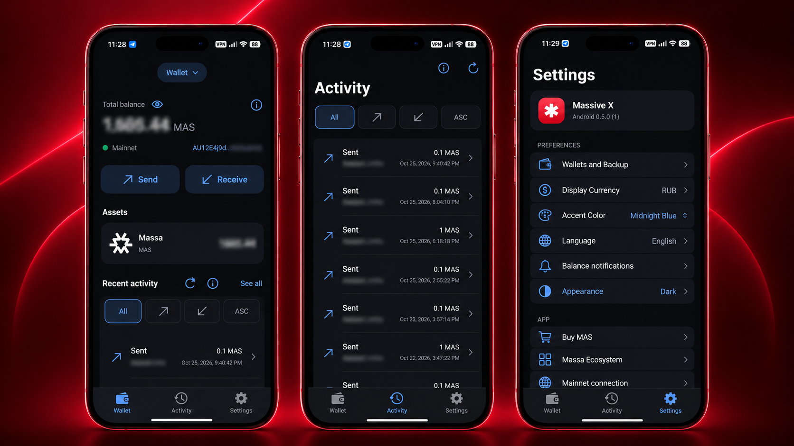

# Massive X Android

A native Kotlin / Jetpack Compose, self-custodial wallet for **Massa Mainnet**. Independent community software; not affiliated with or endorsed by Massa Labs.

**Public Testing · 0.5.0 (2)** · Android 8.0+ · Protected wallets and Send require Android 11+ and a secure device lock.

**[Download the signed APK](https://github.com/whoisfedor/massive-x-android/releases/download/v0.5.0-beta.2/Massive-X-Android-0.5.0-beta.2.apk)** · [Release notes](https://github.com/whoisfedor/massive-x-android/releases/tag/v0.5.0-beta.2)

**Testing prerelease:** the exact beta.2 APK has not been independently audited or had independently verified funded end-to-end acceptance. Begin with disposable, unfunded wallets; any use with funds is at your own risk. This is not a Google Play release.

## Interface preview



*Promotional composition using Android interface captures; selected account details are blurred. Device frames and background are illustrative.*

Six languages: English, French, Russian, Spanish, Simplified Chinese and German. [Website](https://massive-x.com/) · [Support/security](mailto:info@massive-x.com).

## Install or update

1. Download the APK above and verify it using the instructions below.
2. Open it and, if requested, allow **Install unknown apps** for your chosen browser/file manager. Revoke that permission afterward if desired. Do not disable Play Protect or phone security. Device/region restrictions may apply; see [Android developer verification](https://developer.android.com/developer-verification).
3. Create a disposable wallet or import your own backed-up key. Keep an independent private-key backup offline; reinstalling the app is not wallet recovery.

Package: `com.massivex.android`. Install updates in place. **Do not uninstall or clear wallet data to resolve a signature mismatch**; preserve your backup and stop for a compatibility review. The separate development package is `com.massivex.android.dev`.

## Features and compatibility

| Capability | This build |
|---|---|
| Watch-only wallets | Android 8.0+ / API 26+; public reads and Receive without signing keys |
| Create / private-key import / protected backup / Send | Android 11+ / API 30+, secure PIN/password/pattern and supported device authorization required; fails closed otherwise |
| Import encrypted YAML | Supported single-account Massa Version 1 format and its existing password |
| Multiple wallets | Select, name, rename, authenticated backup and scoped removal; unresolved transfer locks prevent unsafe removal |
| Mainnet | Confirmed/candidate balances, public QR/copy/share, indexed activity, exact MAS amounts, fee-aware Max and native transfer review |
| Personalization | Dark/Light/System, three accent colors and four icons; **Classic is the default** |
| Estimates | Optional fiat/crypto estimates via public providers; unavailable/stale quotes do not invent balances |
| Notifications | Optional confirmed-balance checks, off by default; Android/OEM scheduling may delay or suppress them |

No recovery-phrase/BIP39 derivation, YAML export, staking, other chains, hardware-wallet integration or cloud recovery is advertised. The phone interface requests portrait. Android large-screen/windowing behavior may differ.

## Mainnet Send

The signed APK supports real owner-initiated Mainnet MAS transfers. Send requires an immutable review, deliberate confirmation, fresh device authorization, local signature verification and a durable attempt record before one official-RPC submission.

Unknown outcomes are never automatically resent. **Do not repeat a payment after a timeout**; retain its operation ID and reconcile it. Source locks remain until matching, separated final reports and durable resolution satisfy the [release security policy](docs/RELEASE_SECURITY.md). Provider finality is operational trust, not independent consensus verification. Missing or conflicting evidence remains unresolved.

## Security and recovery

- Wallet seeds use identity-bound Android Keystore AES-GCM encryption and fresh action authorization. Hardware backing is not assumed, and wrapping is not hardware-backed Ed25519 signing.
- Keys and protected records are excluded from Android backup/device transfer. App removal, lock changes or Keystore/device loss can make keys unrecoverable; keep an independent offline backup.
- Public pages permit screenshots. Sensitive entry and reveal use `FLAG_SECURE`; reveal hides on exit/background or after 30 seconds. Cameras and a compromised OS remain risks.
- Authenticated key copies may remain in the clipboard after navigation/backgrounding. Android may clear them, and other software may retain copies. Manual Clear affects only the matching app-owned clip; clipboard copying is not an offline backup.
- Local rollback, compromised devices, multi-device use of a key, dishonest providers and missing history remain risks.

See [security reporting](SECURITY.md), the [security model](docs/RELEASE_SECURITY.md) and [Android privacy disclosures](PRIVACY.md). Never send keys, YAML passwords or device PINs to support.

## Network and privacy

The app connects directly over HTTPS to Massa RPC (`https://mainnet.massa.net/api/v2`, chain 77658377) and explorer history (`https://explorer-api.massa.net`). Providers see IP/timing and requested public addresses/operation IDs; authorized Send submits public signed operation data. Private keys are not sent to these providers. Explorer labels do not establish finality.

CoinGecko/Frankfurter provide estimates without intentional wallet-address attachment. External exchange/ecosystem links do not automatically connect a wallet. See [PRIVACY.md](PRIVACY.md) for clipboard, capture, notification and provider details. The app links to this Android disclosure; the [website privacy policy](https://massive-x.com/privacy/) remains iOS-specific.

## Build from source

Check out `v0.5.0-beta.2`. Use Android SDK platform 36, Build Tools 35.0.0 and a compatible JDK; the verified toolchain uses JBR 21, Gradle 8.13, AGP 8.11.1 and Kotlin 2.1.20.

```sh
./gradlew --dependency-verification strict test :app:assembleDebug :app:assembleRelease :app:assembleDebugAndroidTest :app:lint :app:lintRelease
```

`assembleRelease` produces an **unsigned** APK. The publisher APK is separately aligned and signed; a build signed with another key cannot update the publisher installation. See [build and verification](docs/BUILD_AND_VERIFY.md) for toolchain pins, offline setup and signing instructions.

## Tests

[Release verification](PUBLICATION.md) records beta.2 regression, signed-APK and in-place upgrade results, with prior release results separately labeled. Suites cover core interoperability/YAML, protected storage/authorization, exact amounts, network parsing, journal persistence, source isolation and conservative finality. [Test fixtures](docs/TESTS.md) are public, deliberately compromised identities: **never fund them**.

## Verify the download

Version **0.5.0 (2)** · [source tag `v0.5.0-beta.2`](https://github.com/whoisfedor/massive-x-android/tree/v0.5.0-beta.2).

APK SHA-256:
`d427129de3cdd88277dd130253c49cae8cf2c2e483214a638b5b950be7886d93`

Download [SHA256SUMS](https://github.com/whoisfedor/massive-x-android/releases/download/v0.5.0-beta.2/SHA256SUMS) beside the APK and run:

```sh
shasum -a 256 -c SHA256SUMS
apksigner verify --verbose --print-certs Massive-X-Android-0.5.0-beta.2.apk
```

On Linux, use `sha256sum -c SHA256SUMS`. On Windows, use `Get-FileHash .\Massive-X-Android-0.5.0-beta.2.apk -Algorithm SHA256` and compare with SHA256SUMS. `apksigner` is included in Android Build Tools; a [signature receipt](https://github.com/whoisfedor/massive-x-android/releases/download/v0.5.0-beta.2/APK-SIGNATURE.txt) is also available.

Expected signing-certificate SHA-256:
`CE5A117B362095A6F610266D1102525A51C8440B48A0B68412849EFE2D76030F`

A matching certificate establishes publisher signing continuity, not safety. Keep wallet data intact when updating.

## Roadmap

Charts, address-book improvements and broader ecosystem features remain plans, with no guaranteed dates.

## License and attribution

Original application source: [MIT](LICENSE), copyright (c) 2026 Fedor Ovchinnikov. Artwork, icons, the promotional preview, names and trademarks are excluded; see [asset/trademark terms](ASSETS_AND_TRADEMARKS.md). Third-party software retains its own licenses and notices in [THIRD_PARTY_NOTICES.md](THIRD_PARTY_NOTICES.md) and `third-party/`.
